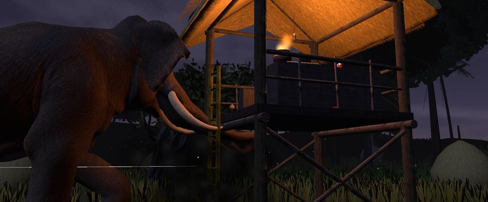
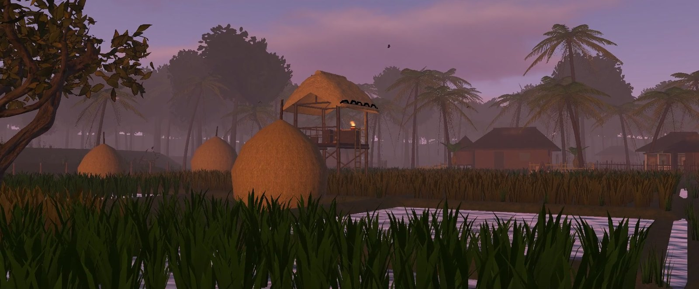
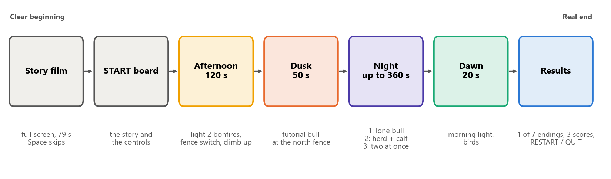
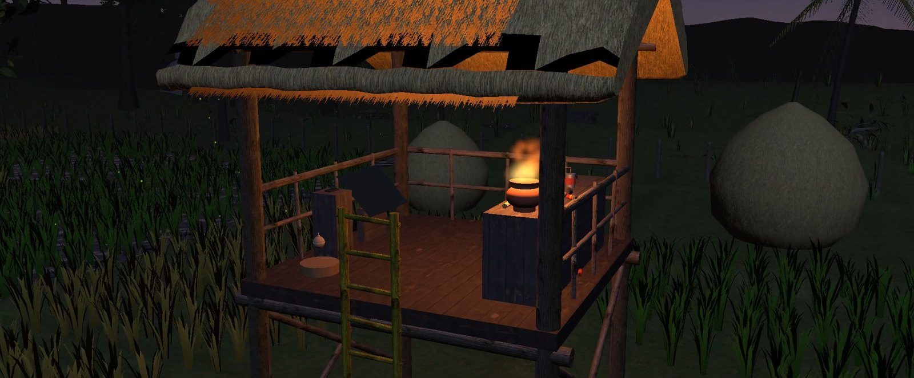
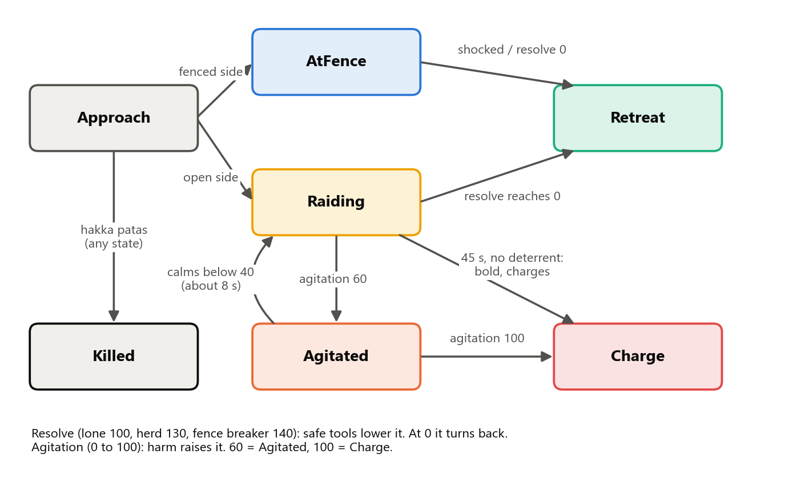
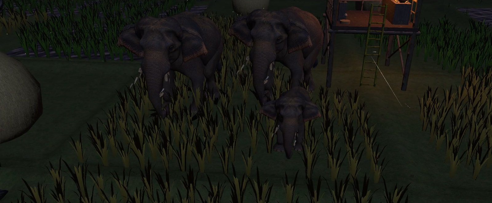
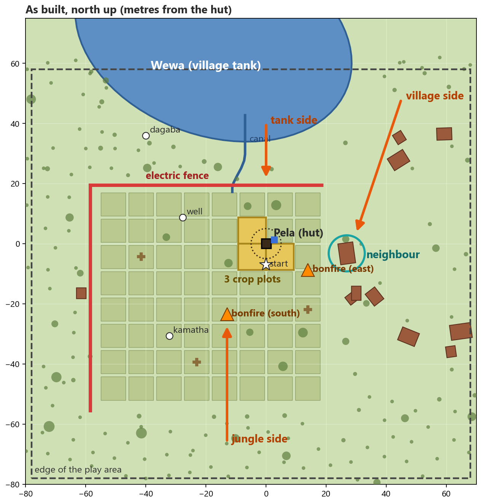

<p align="center">
  
</p>

<h1 align="center">Night Watch</h1>

<p align="center">
  <b>A VR training night in a Sri Lankan paddy field.</b><br>
  Guard the crop from wild elephants with safe, non-lethal methods, and keep everyone alive:<br>
  you, your neighbour and the elephants.
</p>

<p align="center">
  
  
  
  
  
</p>

<p align="center">
  INTE 42312 Virtual and Augmented Reality · Group project · 2026
</p>

---

## The story

Every harvest season, farmers in Sri Lanka spend the night in a **pela**, a small watch hut on
stilts beside the paddy field. Wild elephants come out of the jungle to eat the ripe rice. The
farmer has to turn them back without hurting them and without getting hurt.

In **Night Watch** you are that farmer. You prepare the field in the afternoon, climb into the
hut at dusk and face three waves of elephants in the dark. You have only the tools a real farmer
has: fire, firecrackers, noise and a phone to warn the neighbour. Your choices decide which of
seven endings you reach at dawn.

<p align="center">
  
</p>

## One night, start to end

<p align="center">
  
</p>

| Phase | What happens |
|---|---|
| **Story film** | A 79 second film sets the scene. Space or Enter skips it. |
| **START board** | The story in one line and the controls. The clock waits until you press START. |
| **Afternoon** (120 s) | Light the two bonfires, switch on the electric fence and climb into the hut. |
| **Dusk** (50 s) | A tutorial bull tests the north fence. |
| **Night** (up to 360 s) | Wave 1: a lone bull. Wave 2: a herd of two adults and a calf. Wave 3: two elephants at once, one of them a fence breaker. |
| **Dawn** (20 s) | Morning light and birds. The night is judged. |
| **Results** | Your ending, three scores (You, Elephants, Crop), your good choices and tips for next time. RESTART or QUIT. |

## What the farmer can do

| Tool | How to use it | What it does |
|---|---|---|
| 🔥 **Fire torch** (pandama) | Grab it, light it at the fire pot, face the elephant | Elephants in front stop and lose their will to come closer |
| 🧨 **Firecrackers** (ali wedi), 8 of them | Use to light, use again to throw | Elephants within 15 m run. Hitting an elephant is a wrong choice |
| 🥫 **Tin cans** | Use to bang them | Noise, a small scare. Works best before the elephant reaches the field |
| 🔦 **Flashlight** | Use to switch it on | Find elephants in the dark |
| 🪵 **Bonfires** and ⚡ **fence energiser** | Point and grab, in the afternoon | Keep elephants back all night |
| 📞 **Phone** | Point and grab | Warns the neighbour to stay inside |
| ☠️ **Hakka patas** | A warning shows first | An illegal bait that kills the elephant. It is in the game on purpose, as the choice a farmer must never make |

<p align="center">
  
</p>

## The advanced feature: an elephant AI that reacts to you

Each elephant is driven by two values.

- **Resolve** is how much it wants the rice (a lone bull starts at 100, a herd at 130, the fence
  breaker at 140). Safe tools lower it. At 0 the elephant turns back to the forest.
- **Agitation** goes up when the elephant is harmed or scared too close. At 60 it stops and
  trumpets. At 100 it charges. It calms down in about 8 seconds if left alone.

On top of that:

- **Habituation:** an elephant gets used to each tool on its own, so the farmer has to mix them.
- **Herds:** a leader decides, the others follow, and the calf stays beside its mother. Scaring
  the calf angers the mother.
- **Boldness:** an elephant left raiding for 45 seconds with nothing to stop it charges the hut.
- **Navigation:** elephants walk on a NavMesh (a walk map) sized for an elephant's body, so they
  go round the hut and the fence instead of through them.

<p align="center">
  
</p>

<p align="center">
  
</p>

## Seven endings

| Good | Bad |
|---|---|
| ✅ Everyone is safe | ❌ An elephant was hurt |
| ✅ Safe, but the crop is lost | ❌ You survived, but you were hurt |
| | ❌ Your neighbour was killed |
| | ❌ You did not survive the night |
| | ❌ An elephant was killed |

## The world

The game is set in a Sri Lankan farming village: the hut in the middle of the paddy, a wewa
(village tank) to the north, a canal, a dagaba, a well, a kamatha (threshing floor), the
neighbour's house and the village houses. Elephants come from three sides: the tank, the jungle
and the village.

<p align="center">
  
</p>

## Controls

The game runs on a VR headset through OpenXR. Without a headset it runs with keyboard and mouse
through the **XR Interaction Simulator**. Both use the same named input actions.

| Action | Headset | Keyboard and mouse |
|---|---|---|
| Look | Turn your head | Hold the right mouse button |
| Walk | Walk | W A S D |
| Teleport | Thumbstick forward | I |
| Snap turn / turn around | Thumbstick left, right / back | J, L / K |
| Point at a thing | Aim the controller (it turns yellow) | Move the mouse |
| Grab or press | Grip | G |
| Use what you hold | Trigger | T |
| Left hand | Left controller | Shift + G / Shift + T |
| Skip the film | A | Space or Enter |
| Quit | QUIT button on the results board | Esc |

Comfort: teleport and snap turn only, with a short fade to black. The camera is never moved
for you.

## Run the project

1. Install **Unity 6000.3.25f1** (Unity 6.3 LTS) through Unity Hub. Use this exact version.
2. Clone this repository, then in Unity Hub choose **Add > Add project from disk** and pick the
   folder that holds `Assets`, `Packages` and `ProjectSettings`.
3. Open it. The first open takes 10 to 20 minutes while Unity builds its `Library` folder.
4. Open **`Assets/Scenes/NightWatch.unity`** and press **Play**. Only this scene is the game.

To make a Windows build, use the menu **Night Watch > Build Windows**.

## How it is built

| | |
|---|---|
| Engine | Unity 6.3 LTS (6000.3.25f1), Universal Render Pipeline 17.3, made from Unity's VR template |
| XR | XR Interaction Toolkit 3.5.1, OpenXR 1.17.1, Input System 1.20.0 |
| AI | AI Navigation 2.0.16 (NavMesh) and our own elephant AI |
| Scene | Built from code: **Night Watch > Build Full Game** rebuilds the whole scene from the editor tools |
| Sound | Made in code by simple sound synthesis, except the elephant trumpet and the cow moo (recordings) |
| Shaders | Our own water, sky and wind (foliage) shaders |

```
Assets/
├── Scenes/NightWatch.unity      the game scene
├── StreamingAssets/             the story film (MP4)
└── NightWatch/
    ├── Scripts/                 game code: story, elephant AI, tools, neighbour, screens, sound
    ├── Editor/                  editor tools that build the village, hut, field and screens
    ├── Shaders/                 water, sky, clouds, foliage
    ├── Village/                 the village models and its generated parts
    ├── Characters/              the neighbour and the cattle
    └── Sky/, Textures/, Fonts/  pictures and fonts (see CREDITS.md)
```

## Limitations

- No headset was available, so the game was tested in the XR Interaction Simulator and in the
  Windows build with keyboard and mouse. Real comfort and headset frame rate are not yet tested.
- The elephant AI is a simple training model, not a scientific model of elephant behaviour.
- The elephant trumpet is a library sound, not a recording of an Asian elephant.

## Credits

The 3D models, sky pictures, textures, two sound recordings and the Cinzel font are by other
artists, used under CC BY 4.0, CC0, SIL OFL and the Tunetank Free License. The full list with
authors, links and licences is in **[CREDITS.md](CREDITS.md)**, and the same credits are shown
in the game on the results board.

Everything else (the scripts, editor tools, shaders, the hut, the tools, the field and the
code-made sounds) was made by the team.
